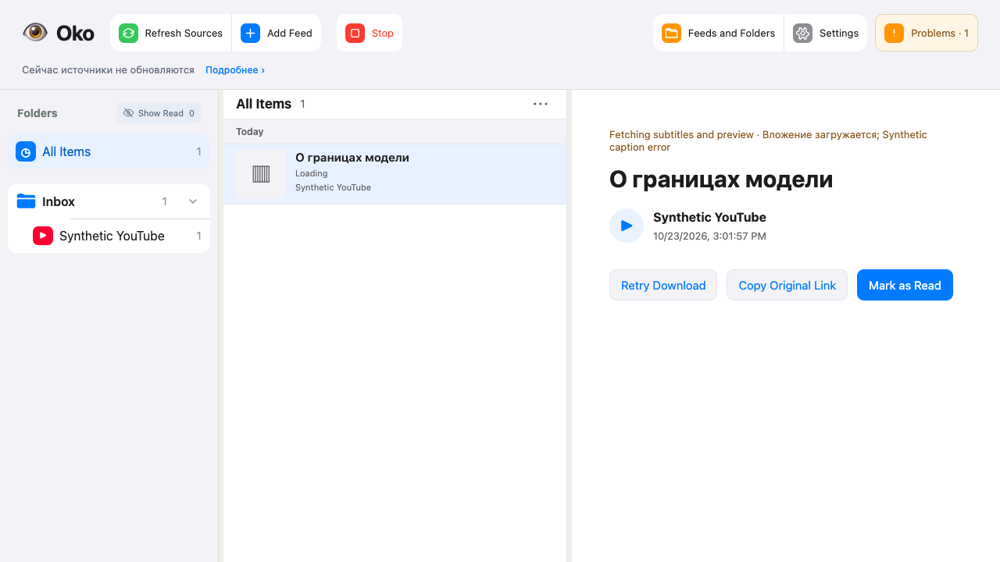
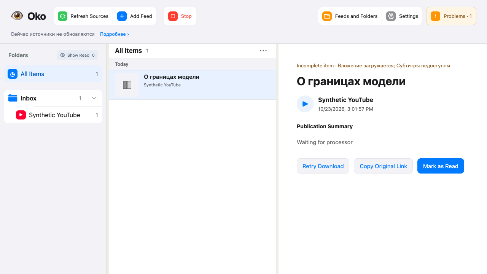
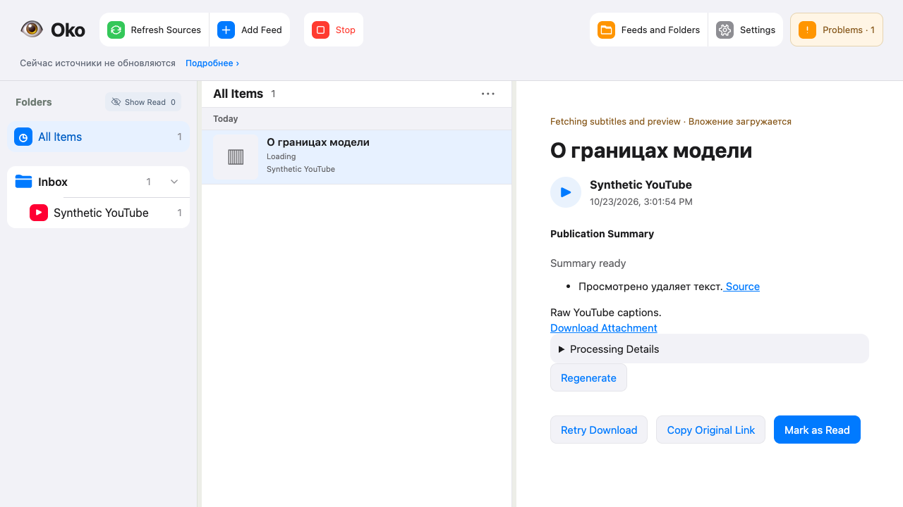
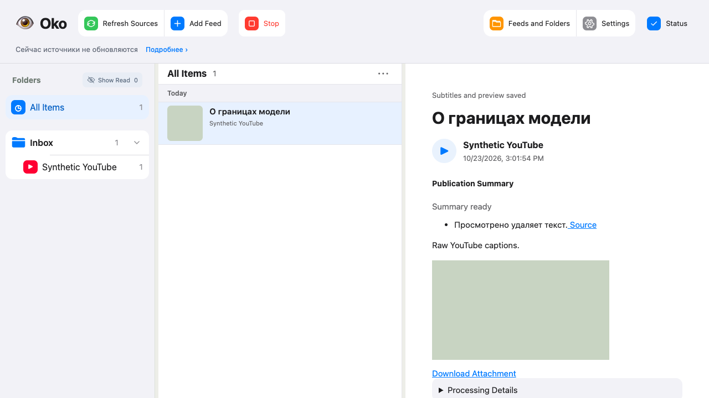

# Проверка YouTube Publication — #95

База: bf38a757efdfa341aa582dccb5f2f23d4ba5fcf7. Коммиты реализации: 1f0fef1,
702b972, 9346fa3. SQLite и файлы временные, источники и модели синтетические.
Рабочее хранилище не мигрировалось, установленный выпуск не перезапускался.

## Выполненные проверки

- Итоговый серверный прогон на 9346fa3: **892 passed**, contracts и mypy прошли,
  `20261023T120305Z-f617cff0`, 114.50 с. Рабочее дерево не менялось во время проверки.
- До уточнений прошли 80 смежных тестов YouTube, связанных публикаций и медиа.
  После исправлений прошли 37 целевых тестов; ещё 20 тестов адаптера и переноса
  прошли после исправления пустого Atom и переноса сериализации курсора к адаптеру.
- mypy: 110 файлов, без ошибок.
- HTTP проверяет независимость обложки и субтитров, исходные субтитры после
  фильтра, high importance при выключенном theses, пустой результат только при
  подтверждённом отсутствии, смену/неизменность/ошибку перепроверки, неизменяемые
  URL и отсутствие локального файла как ошибку входа. Офлайн-перенос сохраняет
  настройки и принятый результат; источник и backup побайтно совпадают.
- Общая пауза YouTube и proxy переживают restart; ручной retry не обходит паузу,
  RSS продолжает работу. Проверка расширена на новый путь: обе версии прошли.
- Полный `all` на неизменяемом снимке 702b972/tree a7424381: **FAIL**, 881 Python
  passed / 1 failed; браузер 336 passed / 2 skipped, HTTP 9 passed, инструменты
  4 passed, contracts/types/build/lint/syntax/diff/entrypoint прошли. Отчёт
  `20261023T115850Z-0b025fe3`, 164.50 с. Старый owned-worker тест закрывал setup
  сессию и отменял запрос до подключения reader. Исправлена очередность присутствия;
  таймаут и проверки не ослаблялись. Повтор всего `test_youtube.py` прошёл:
  `20261023T120223Z-5f7a315f`, 8.19 с.
- Ранний backend/types дал успешные тестовые шарды, но итог **FAIL checkout_changed**:
  параллельно редактировались документация и браузерные fixtures
  (`20261023T114943Z-ea04c4d8`). Это не чистый полный прогон.
- Финальный целевой Playwright: **2 passed**, tooling/browser types прошли,
  `20261023T120150Z-ba155a2a`, 12.20 с. Проверяется видимая ошибка, retry,
  отсутствие и появление субтитров, тезисы до обложки и сохранение текста/тезисов
  после фактически отрисованного изображения. Предыдущие ошибки сужения типов,
  принятия версии вкладкой и селектора исправлены; сценарии не пропускались.
- Финальные staged/syntax/lint/types/contracts/diff/tooling-types/browser-types
  прошли: `20261023T120518Z-e22ce57d`, 3.84 с.

## Независимое ревью

Spec: P1 высокой важности воспроизведён и исправлен; повтор на 702b972 — 0 findings,
финальная дельта 702b972…9346fa3 — 0 findings. Независимые проверки: 15 тестов
адаптера/публикации, 10 access/proxy/restart, отдельный тест пустого Atom прошли.

Standards: 0 документированных нарушений. Замечание о знании мигратором формата
курсора исправлено: формат теперь принадлежит адаптеру; повтор — 0 открытых замечаний.

## Снимки браузера

Получены Playwright и просмотрены. Настоящий YouTube, аккаунты и платные модели
не использовались.

