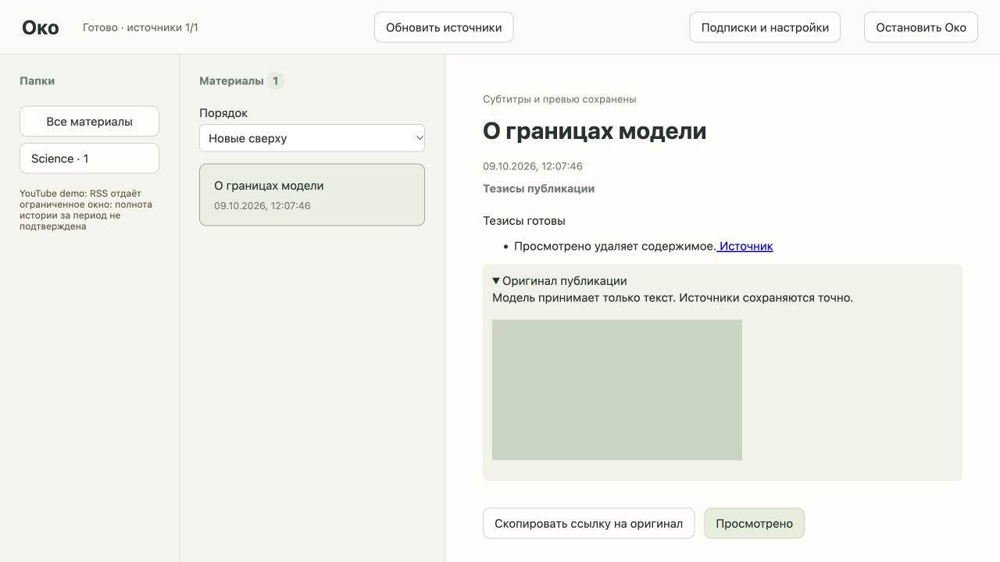

# №08: обновления и тезисы YouTube

2026-10-09. Исходная точка: `cf0aa40755da6b6237f6e29065528c0bfc52e3a2`.

## Реализовано

Импортированный YouTube-фид подключается в общей очереди. Устойчивый ID видео, каноническая ссылка, заголовок, время и локальное превью. Высокая важность включает субтитры и тезисы автоматически; для остальных действует режим фида с наследованием. Субтитры — исходный текст, тезисы используют существующий контракт, промпт, выбранный обработчик и разрешения. Нет видео/аудио/ASR. Нет генерации по заголовку без субтитров. Ошибка, отсутствие и незапрошенные субтитры различаются, доступен повтор.

Общий lifecycle сохраняет защиту от поздних ответов; просмотр удаляет Markdown субтитров, превью и тезисы. Перезапуск сохраняет готовый результат и не запускает модель повторно.

## Проверки

Основной seam — API с реальным временным SQLite/файлами. Внешние Atom, превью, субтитры, llama.cpp и Codex подменены. `tests/test_youtube.py`: импорт без дубля, высокая важность, эффективный промпт, локальные превью, удаление и повторная выдача просмотренного ID; включение режима обычного фида, отсутствие/ошибка/повтор субтитров без выдуманного summary; разрешение Codex и восстановление готового непросмотренного материала; устойчивый к отмене ответ после просмотра, остановки и закрытия последней вкладки.

## Настоящее подключение — не принято

В браузере A проверены выбор карточки, тезисы со ссылкой, раскрытие субтитров, локальное превью, кнопка копирования и остановка со сбросом материала. Использованы синтетические Atom, субтитры и ответ Codex; скриншот не доказывает настоящее подключение:

Публичный Atom TED-Ed `UCsooa4yRKGN_zEE8iknghZA`: `ConnectTimeout`, в том числе с обычными настройками среды. Запросы настоящих субтитров `H14bBuluwB8` и `jNQXAC9IVRw` не завершились успешно. Содержимое не печаталось и не сохранялось; проверка не использовала личные аккаунты. Получение настоящих доступных и отсутствующих субтитров не доказано. №08 остаётся `integration-pending` до сетевой проверки. Реальная модель llama.cpp также остаётся отдельной приёмкой №06.

## Standards

Ревью ожидается.

## Spec

Ревью ожидается; ограничение реальной интеграции указано отдельно.
